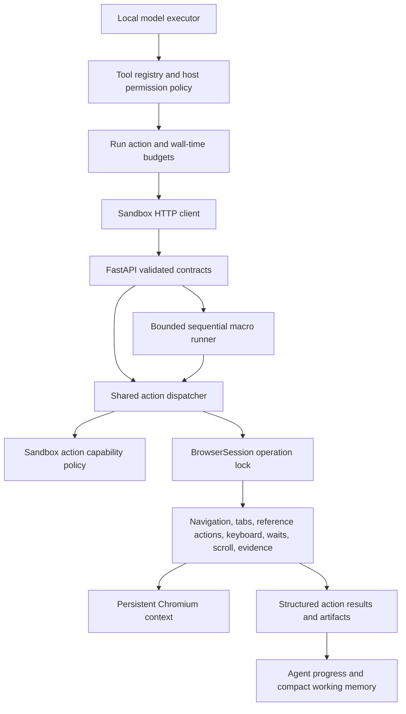

# XBrowser execution architecture

Status: session, reference, shared execution, bounded macro, and host progress
layers implemented, with trusted task acceptance, sandbox egress/approval policy,
actual-token budgeting, and optional vision fallback. See
[the execution guide](xbrowser-execution.md), [security controls](xbrowser-security.md),
and the [validation report](xbrowser-validation.md) for measured deployment and model results.

## Ownership and boundaries

The model sees JSON tool arguments and compact text observations. It never owns
Playwright objects, profiles, locks, or arbitrary JavaScript. The sandbox is the
execution authority. Host permissions do not replace sandbox checks.

## Single execution path

The controller dispatches nine actions: open, observe, click, type, press, scroll,
tabs, wait, screenshot. Public single-action requests acquire the session lock
once. A macro holds that same lock across its entire sequence and invokes only
the controller's already-locked dispatcher. This avoids lock recursion and tab
changes from competing requests between macro steps.

Session owns lifecycle, profiles, tab IDs, and reference invalidation. It provides
internal navigation/tab primitives for the dispatcher, plus public lock-owning
helpers for non-HTTP callers. FastAPI handlers validate/translate requests and
return structured errors; they contain no separate implementation of an action.
Legacy endpoints remain aliases or adapters to the shared execution path.

Sandbox capabilities are server configuration, never model arguments. The
dispatcher checks the capability of every action, including every macro step.
Macros cannot invoke shell tools, lifecycle operations, evaluation, other macros,
or unknown actions. Navigation and artifact checks run through the existing
session methods. Domain/IP/redirect policy and sensitive-form authorization are
implemented as independent enforcement layers; see the security guide.

## Macro contract

`browser_run` accepts 1–20 typed sub-actions, a shared timeout (at most 90 seconds),
and an action allowance. The complete sequence is schema-validated before any
action starts. Runtime capability checks also apply per step. Execution is
sequential, stops on first failure, and records every attempted action. Results
include the failed index, attempted count, partial artifacts, and final state.
Successful earlier actions are never rolled back or replayed.

The run deadline includes waiting for the session lock and browser startup.
Each action also has a bounded timeout. Timeout/cancellation after dispatch has an
uncertain outcome and requires observation before deciding what to do next.
Cancellation propagates to the runner, releases the lock, and does not execute
later steps. Screenshot creation cleans partial files on cancellation.

The host caps macro length by remaining run actions and clamps its deadline by
remaining run time. Attempted sub-actions count toward the run budget. If the
transport loses the result, charge the full reserved macro allowance because the
number actually executed is unknown. A macro is one model call, not one action.

## State, history, and progress

Repeat signatures hash canonical complete arguments and browser scope/state;
they do not truncate arguments or exempt scrolling. Structured evidence of no
movement can additionally stop repeated scrolling even on a dynamically changing
page. Global action and time caps remain authoritative.

A tool success records action evidence and resets retry errors. It does not
advance a plan step. The executor explicitly emits `STEP_DONE:` after completing
the current objective; `DONE:` remains a model assertion about the whole task.
Neither assertion becomes deterministic task verification automatically.

Only the newest successful observation is retained in working memory. Superseded
observation payloads become short snapshot references; errors, non-observation
action outcomes, and artifact evidence remain. Full results stay in run records.

## Verification boundaries

Action verification answers mechanical questions: field value matches, tab
selected, scroll moved/reached an edge, file created, or wait condition satisfied.
Task verification must check acceptance criteria originating from the user's
request or trusted caller: required artifact count/contents, expected destination,
or report completeness. Implemented task-check contracts keep those criteria
separate from model-supplied assertions. Actions retain
`task_verification=not_evaluated`; trusted checks supply the completion decision.

## Implemented rollout gates

1. Complete shared action execution and bounded macros. Gate: local fixture
   navigate → five screenshots workflow, partial failures, concurrency, deadlines,
   cancellation, capability denials, and legacy compatibility.
2. Integrate host tools, action accounting, explicit plan progress, repeat guards,
   and observation compaction. Gate: scripted-model regression tests plus the
   existing suite; no LLM confidence needed to prove the mechanics.
3. Add trusted task acceptance checks and hardened navigation/sensitive-action
   policy. Gate: deterministic security and task-completion fixtures.
4. Validate Docker/Xvfb/noVNC, run repeated evaluations with the local model, and
   measure success, latency, tokens, and calls. Only then tune schema subsetting,
   tokenizer budgets, and optional visual marks.

Do not describe an implemented layer as production hardened or real-model proven
until its corresponding gate has been run.
